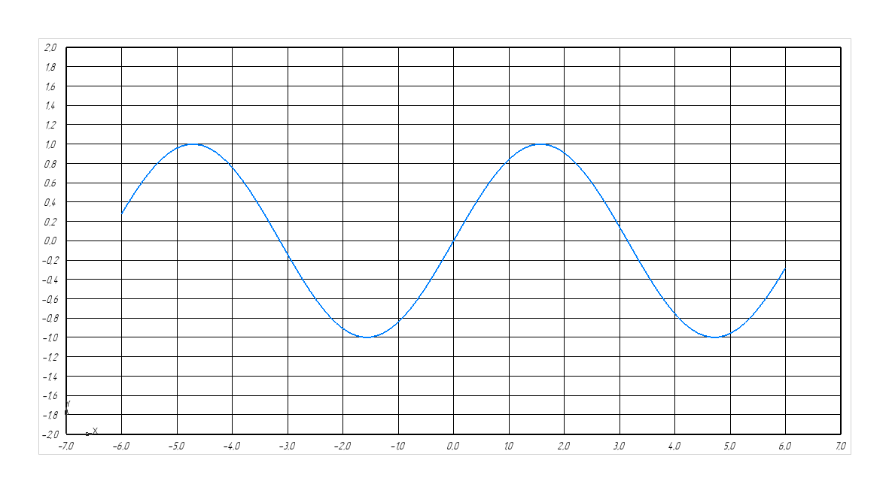

# Описание
Инструмент для создания графиков на чертеже в программе КОМПАС-3D.


[](https://www.youtube.com/watch?v=2_AllszUrcE)

# Использование

## Использование без установки.
1. Скачайте исходный код проекта.
2. Откройте КОМПАС-3D, создайте новый файл чертежа.
3. В панели КОМПАС-Макро -> Макросы -> Создать.
4. Выберите имя для файла макроса, например `test1.cdm`. Откроется среда разработки PyScripter.
5. Скопируйте код из примера (`examples/A00_simple_line.cdm`) в конец файла `test1.cdm`.
6. Раскомментируйте следующие строчки и добавьте абсолютный путь до кода библиотеки:
```
# import sys
# sys.path.append(r"/абслютный/путь/до/artchart/src/")
```
Например:
```
import sys
sys.path.append(r"C:/Users/user/Documents/Dev/artchart/src/")
```
7. Нажмите кнопку Run (Ctrl + F9).
*) При запуске, скрипт создаст график на новом виде активного документа-чертежа.

## Использование с установкой (The Hard Way)
Ввиду отсутствия pip во встроенной среде разработки PyScripter, приходится использовать древние методы установки. Такой вид установки позволяет не заморачиваться с указанием пути до библиотеки в каждом новом файле скрипта.
1. Скачайте релиз проекта `artchart-<version>.tar.gz` из репозитория в разделе релизы и распакуйте его. В конечном счёте должна получится папка `artchart-<version>` с файлами библиотеки.
2. Откройте КОМПАС-3D.
2. Tools -> Command Prompt.
3. Переходим в папку распакованного архива artchart-<version>:
```
cd "path/to/artchart-<version>"
````
4. Запускаем установку:
```
python setup.py install
```
2. В КОМПАС-3D создайте новый файл чертежа.
3. В панели КОМПАС-Макро -> Макросы -> Создать.
4. Выберите имя для файла макроса, например `test1.cdm`. Откроется среда разработки PyScripter.
5. Скопируйте код из примера (`examples/A00_simple_line.cdm`) в конец файла `test1.cdm`.
7. Нажмите кнопку Run (Ctrl + F9).
*) При запуске, скрипт создаст график на новом виде активного документа-чертежа.
